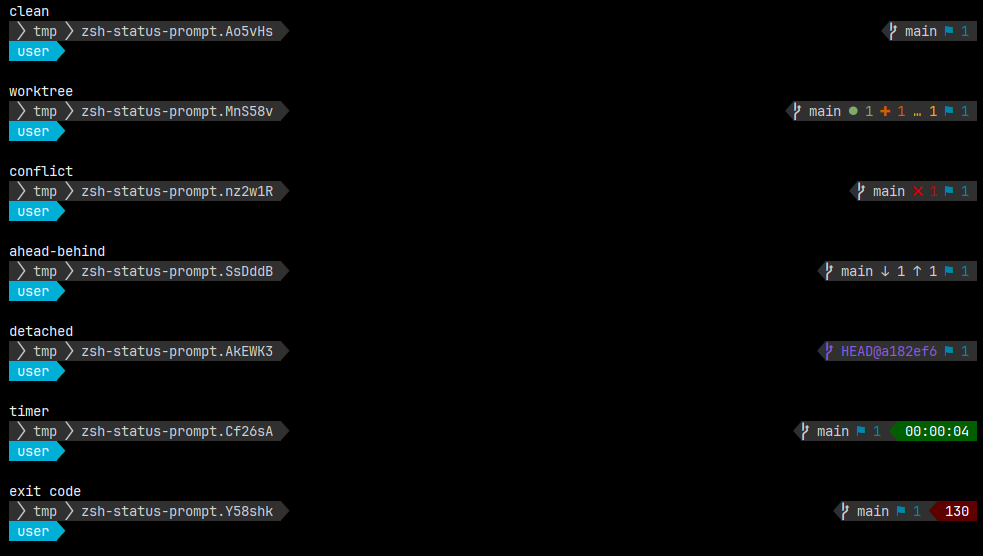

= zsh-status-prompt

A small, zsh-native, two-line, powerline-style status prompt.

Line 1 shows the current directory on the left and git status, the previous command duration, and non-zero exit status on the right.

Line 2 stays reserved for command input.

== Intentions

* Keep the prompt code small, zsh-native, and easy to source from `~/.zshrc`
* Less machinery: no Python app, no framework, no theme system to learn.
* Two-line prompt, having a dedicated input line with no clutter
* Provide the exact status information you actually use
* Stay configurable, but avoid turning this into a general prompt system
* Make the prompt behavior predictable, readable, and easy to modify
* Keep optional pieces opt-in, like showing the hostname or privilege character

== Features

* Two-line zsh prompt
* Powerline-style separators
* Git branch, detached HEAD, and working tree status
* Duration of commands that took longer than 3 seconds
* Non-zero exit status display
* Optional `user@hostname` identity display
* Optional hiding of the user name, leaving only `hostname`
* Optional privilege character (`%` or `#`) after the name
* Optional elapsed-time block for long-running commands
* Optional hiding of non-zero exit status
* Empty input clears stale exit status
* Active prompt redraw on terminal resize
* Configurable colors using xterm color IDs or supported xterm color names

== Prompt Layout

[source,text]
----
path                                                 git status / timer / exit
identity ❯ command input starts here
----

The path is shortened to the last five path segments for deep directories.

Git status uses these markers:

*  for the current branch
* `HEAD@abcdef0` for detached HEAD state
* `↓ n` for commits behind upstream
* `↑ n` for commits ahead of upstream
* `● n` for staged changes
* `✖ n` for conflicts
* `✚ n` for unstaged tracked changes
* `… n` for untracked files
* `⚑ n` for stashes

== Requirements

* `zsh`
* `git`, for git status information

The prompt uses Powerline glyphs for its separators and branch marker: 

Your terminal font, or one of its fallback fonts, must contain these glyphs.

Otherwise, they may render as boxes `▯` or missing characters `�`.

Many systems already satisfy this via fonts such as:

* Cascadia Code
* JetBrains Mono
* Fira Code
* DejaVu Sans Mono
* Source Code Pro
* Hack
* or any Nerd Font variant

To fix rendering issues, install and select one of these fonts in your terminal.

== Installation

Clone this repository and source the prompt from your `~/.zshrc`:

[source,zsh]
----
source /path/to/zsh-status-prompt/zsh-status-prompt.zsh
----

== Performance

I haven't reached any performance limits with `zsh-status-prompt.zsh` yet, but when it comes to `git` usage in general, it never hurts to think ahead and use these two tweaks:

[source,shell]
----
# Use built-in file system monitors (like `fsmonitor` daemon) to track file
# changes continuously, eliminating the need for Git to scan the whole disk.
git config core.fsmonitor true

# Speed up the scan for untracked files by caching directory contents.
git config core.untrackedCache true
----

This will help with

* very large repositories
* monorepos
* many untracked files
* slow filesystems
* network mounts
* prompts that redraw often
* async prompt rendering
* wanting status without blocking the shell prompt

== Tests

Run the syntax checks and git-state fixture tests:

[source,zsh]
----
./run syntax
./run tests
----

`./run tests` suppresses rendered prompt examples. To inspect or anonymize rendered output, invoke the fixture script directly. For example:

[source,zsh]
----
zsh tests/git-prompt-git-states.zsh --anonymize
----

The default anonymized labels are `user` and `machine`. You can override them:

[source,zsh]
----
zsh tests/git-prompt-git-states.zsh --user user --host machine
----

== Contributing

Contributions are welcome. See link:CONTRIBUTING.adoc[CONTRIBUTING.adoc] for the test and pull-request workflow.

== Versioning

Tagged releases follow https://semver.org/[Semantic Versioning] and use the form `MAJOR.MINOR.PATCH`, for example `1.2.3`. Git tags do not use a `v` prefix.

Before `1.0.0`, releases use `0.MINOR.PATCH` and the documented configuration and behavior may change. From `1.0.0` onward:

* Patch releases contain compatible bug fixes.
* Minor releases add backward-compatible features or options.
* Major releases make incompatible changes, such as removing or changing a documented option or raising the minimum supported Zsh version.

== Configuration

You may set options before sourcing the prompt:

Boolean options use `1` for enabled and `0` for disabled:

[cols="2a,1a,3a",options="header"]
|===
| Variable | Default | Description

| `SHOW_EXITCODE` | `1` | Show a block for non-zero exit status
| `SHOW_HOSTNAME` | `0` | Show `%m`; with username enabled this renders as `user@host`, otherwise `host`
| `SHOW_PRIVILEGE_CHAR` | `0` | Show `%#` after the identity
| `SHOW_TIMER` | `1` | Show elapsed time for commands longer than 3 seconds
| `SHOW_USERNAME` | `1` | Show `%n` on the input line
|===

[source,zsh]
----
SHOW_EXITCODE=0
SHOW_HOSTNAME=1
SHOW_PRIVILEGE_CHAR=1
SHOW_TIMER=0
SHOW_USERNAME=0

source /path/to/zsh-status-prompt/zsh-status-prompt.zsh
----

== Color Configuration

You may set color variables before sourcing the prompt:

[source,zsh]
----
COLOR_AHEAD=Grey82
COLOR_BEHIND=Grey82
COLOR_BRANCH_DETACHED=MediumPurple3
COLOR_CHANGED=DarkOrange3
COLOR_CONFLICT=Red3
COLOR_EXIT_BG=DarkRed
COLOR_EXIT_FG=Grey100
COLOR_PATH_BG=Grey19
COLOR_PATH_FG=Grey82
COLOR_PROMPT_BG=DeepSkyBlue2
COLOR_PROMPT_FG=Grey100
COLOR_RIGHT_BG=Grey19
COLOR_RIGHT_FG=Grey82
COLOR_STAGED=Green
COLOR_STASHED=DeepSkyBlue3
COLOR_TIMER_BG=DarkGreen
COLOR_TIMER_FG=Grey100
COLOR_UNTRACKED=Orange1

source /path/to/zsh-status-prompt/zsh-status-prompt.zsh
----

Numeric xterm color IDs also work:

[source,zsh]
----
COLOR_CONFLICT=160
----

Supported xterm color names are defined in `XTERM_COLORS` inside `zsh-status-prompt.zsh`:

[cols="1a,1a",options="header"]
|===
| Name | ID

| `Green` | `2`
| `DarkGreen` | `22`
| `DeepSkyBlue3` | `31`
| `DeepSkyBlue2` | `38`
| `DarkRed` | `52`
| `MediumPurple3` | `98`
| `Red3` | `160`
| `DarkOrange3` | `166`
| `Orange1` | `214`
| `Grey100` | `231`
| `Grey19` | `236`
| `Grey82` | `252`
|===

== Credits

Inspired by powerline-style shell prompts and built as a small, zsh-native prompt module by J. Thelen.

* https://github.com/powerline/powerline[powerline] was created by Kim Silkebaekken.
* https://github.com/jaspernbrouwer/powerline-gitstatus[powerline-gitstatus] was created by Jasper N. Brouwer.

Git status parsing uses `git status --porcelain=v2`.
